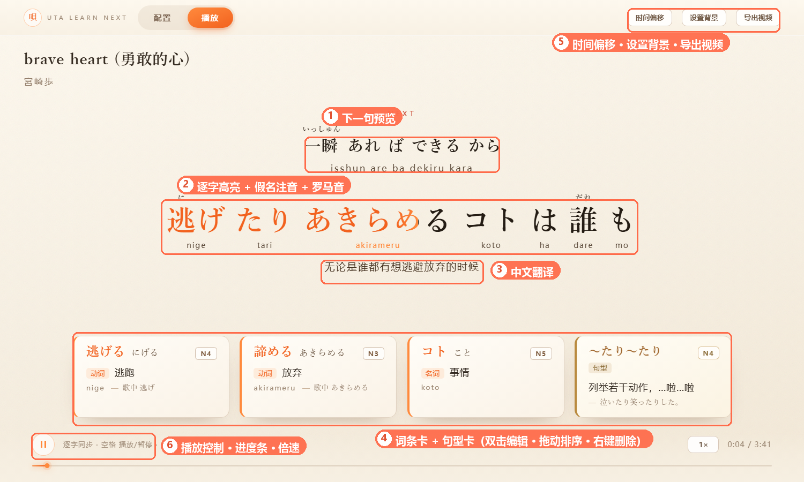
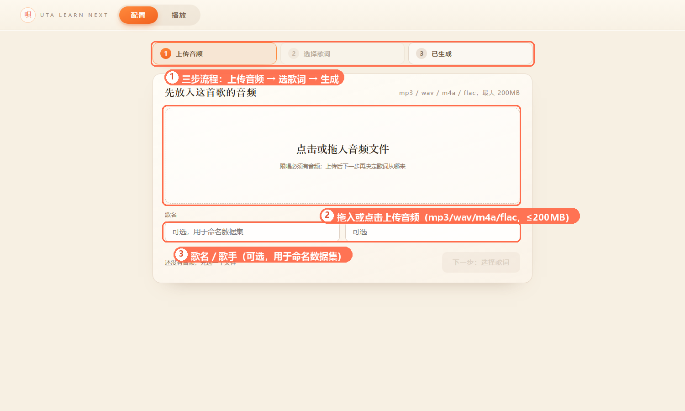
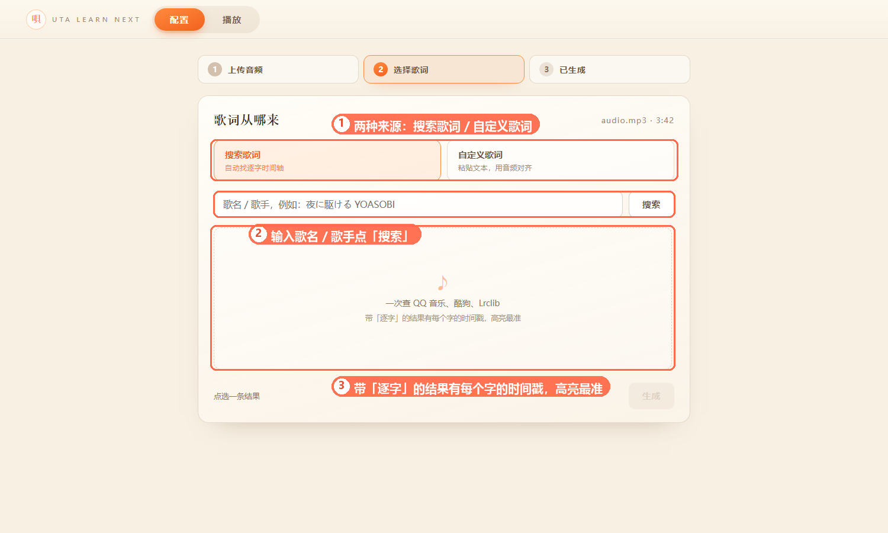
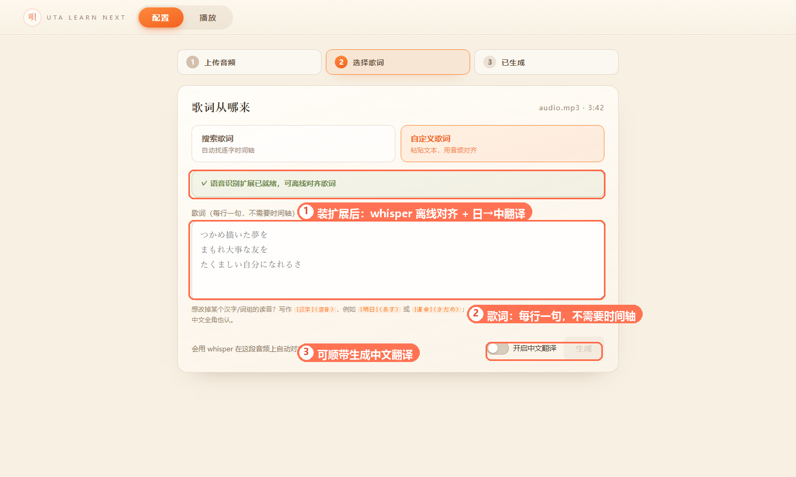
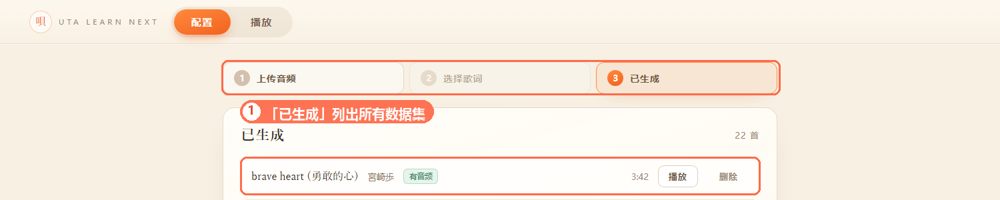
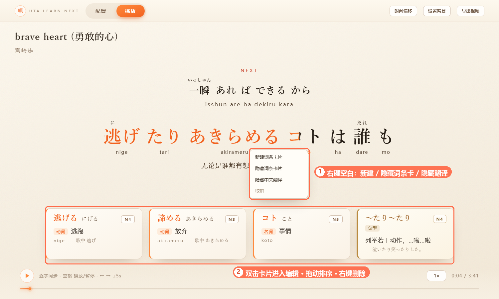
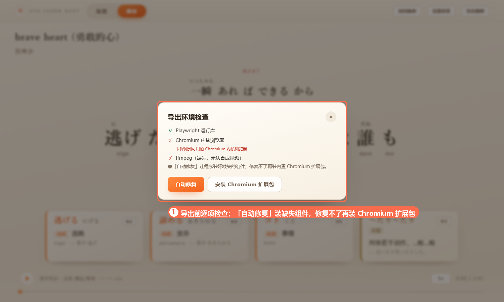

# Uta Learn Next

[](https://github.com/HaneWari/uta-learn-next/releases)
[](https://github.com/HaneWari/uta-learn-next/releases)
[](https://github.com/HaneWari/uta-learn-next/stargazers)
[](./LICENSE)

跟着日语歌学日语：**逐字**卡啦 OK 高亮、标注汉字的假名注音、罗马音、中文翻译，以及按真实词元
（辞书形 + 词性 + JLPT + 中文释义）和句型整理的词汇卡。可以把自己下载的音频配任意歌词源，
也能一键导出 1920×1080 / 60fps 的成片。

**本项目不提供相关音频资源，请自行获取**

本项目在[utalearn](https://github.com/rafaelanobre/utalearn)基础上开发而来。

---

## 界面预览

**跟唱舞台** —— 逐字高亮只标汉字的假名注音、罗马音、中文翻译；下方是当前这一句的词条卡与句型卡。



**配置** —— 放入自己下载的音频，三种来源选一份，剩下的交给它。



**选歌词 · 搜索** —— 一次查 QQ 音乐 / 酷狗 / Lrclib，带「逐字」的源有每个字的时间戳。



**选歌词 · 自定义** —— 粘贴自己的歌词文本，whisper 在你上传的音频上离线对齐；装扩展后可顺带生成中文翻译。



**已生成** —— 所有数据集都在这一步，随时回到跟唱或清理。



**改歌词、改卡片** —— 双击歌词行进编辑（含自定义读音写法）；双击卡片进入编辑、拖动排序、右键删除；右键空白处新建卡片或整首隐藏词条/翻译。




**导出前会检查环境** —— Playwright / Chromium 内核浏览器 / ffmpeg 逐项探测，缺了给「自动修复」或装 Chromium 扩展包的入口。



---

## 快速开始

**普通用户直接下发行包，免安装、解压即用。** 只有核心包必须下，两个扩展包按需——
而且两个扩展包都能在应用里**一键下载安装**（需要时会弹出对应入口），
无特殊情况不必手动去发行版页面。

| 压缩包 | 体积 | 说明 |
| --- | --- | --- |
| `UtaLearnNext-<版本>.zip` | ~290 MB | 完整应用：搜索歌词、生成、跟唱、词汇卡、歌词/卡片编辑。本机有任意 Chromium 内核浏览器（Chrome / Edge / Brave / 360 / QQ 等）即可直接导出视频。 |
| `UtaLearnNext-chromium.zip` | ~316 MB | 可选扩展包（**版本无关**）：内置 Chromium。本机没有 Chromium 内核浏览器又想导出视频时才需要——「导出视频」会先检测环境，缺了可点「安装 Chromium 扩展包」自动装好；手动解压到应用目录得到 `browsers/` 也行。 |
| `UtaLearnNext-custom-lyrics.zip` | ~490 MB | 可选扩展包（**版本无关**）：自定义歌词用的 whisper 识别 + 日→中翻译模型。在「自定义歌词」面板点「下载并安装扩展」自动装到 `models/`；手动解压到应用目录得到 `models/`（内含 `whisper-small/` 与 `translate-ja-zh/`）也行。不用自定义歌词就不用下。 |

核心包解压后双击 **`启动 Uta Learn Next.cmd`** 即可。自带 Python 运行时、ffmpeg/ffprobe
与已构建好的前端；不写注册表、不改 PATH、不需要管理员权限。需要导出但本机没有
Chromium 内核浏览器（Edge 也算，Windows 自带）时，再把 chromium 扩展包解压进来就行——
程序下次启动会自动识别 `browsers/`，不用装、不用改配置。

两个扩展包都**与版本无关**：浏览器二进制和冻结的语音模型远比应用更新慢，
下载一次即可在任意版本上复用，升级应用不必重下。

数据默认写在文件夹内的 `localdata/` 与 `exports/`（便携语义，整个文件夹可拷走）；
如果文件夹不可写（例如解压到受保护目录），会自动回退到 `%LOCALAPPDATA%\UtaLearnNext\`。

<details>
<summary><strong>开发者：从源码运行</strong>（需要 Python 3.12+、Node.js 18+、PATH 里的 ffmpeg）</summary>

```bash
# Windows
dev.cmd              # 需要时才构建，单进程起在 :8000
dev.cmd --rebuild    # 强制重新构建前端

# macOS / Linux
./dev.sh             # 同上
./dev.sh --dev       # 前端走 vite :5173 热更新，API 仍在 :8000
```

首次运行会自动装依赖并构建前端，之后秒开；浏览器打开 <http://localhost:8000/>。
一个进程同时提供页面和 API，关掉窗口即停止。

```bash
cd backend && python -m uvicorn main:app --reload --port 8000   # 后端热重载
cd frontend && npm run dev                                       # 前端 vite 开发服
```

```bash
docker compose up --build                                        # 或者直接用 Docker
```

</details>

<details>
<summary><strong>自己打包发行版</strong></summary>

```bash
python tools/build_portable.py                    # 核心包 + chromium 扩展包
python tools/build_portable.py --no-chromium      # 只出核心包
python tools/build_portable.py --custom-pack      # 只出自定义歌词扩展包（whisper+翻译）
python tools/build_portable.py --no-zip           # 只生成文件夹
python tools/build_portable.py --out D:/build     # 换构建目录（磁盘空间不够时用）
python tools/build_portable.py --zip-out D:/rel --browsers-dir D:/br   # 大文件放别的盘
```

ffmpeg 用的是 **essentials（精简）构建**：静态链接、单个约 104 MB（全量版要 218 MB），
仍包含本应用需要的 `libx264`、`aac`、常见音频解码器与 `fps/setpts/tpad` 滤镜。
只有罕见格式（wma/ape/amr 等）可能解不开，导出与跟唱不受影响。

</details>

---

## 怎么用

界面分「配置」和「播放」两个标签页。

### 配置：把一首歌变成可跟唱的数据集

流程是三步：**先放音频 → 再决定歌词从哪来 → 生成**。

**第 1 步 · 上传音频**（mp3 / wav / m4a / flac，最大 200MB）。跟唱必须有音频。

**第 2 步 · 选择歌词来源**，两种方式：

- **搜索歌词**：同时查 QQ 音乐、酷狗、Lrclib。QQ 音乐和酷狗给的是**逐字时间戳**
  （每个字都有起止时间，高亮最准），Lrclib 只有行级时间。
- **自定义歌词**：直接粘贴文本，每行一句，不需要时间轴，用 whisper 在你上传的音频上自动对齐。
  对齐用的是「切片转写 + 全曲假名全局对齐 + 逐字锚定」：whisper 分短窗识别出词，
  再把所有歌词假名与所有识别假名做一次全局动态规划，逐个音取回它在转写里的时间；
  识别缺失的音按相邻音插值、整行都没识别的按歌速平摊到空白里，音频只覆盖片段时
  自动裁掉没唱到的头尾。在 3 首有逐字真值的歌上逐字平均误差约 **0.3 秒**。
  - **自定义读音**：某个汉字/词组要读成别的音时，写成 `[汉字](读音)`，
    例如 `[明日](あす)`、`[運命](さだめ)`；假名、片假名、罗马音（`[明日](asu)`）都行，
    方括号与圆括号用中文全角（`【】（）`）也认。
  - 该功能需要模型扩展包：在自定义歌词面板点「**下载并安装扩展**」一键装好
  （从本仓库最新发行版拉取 `UtaLearnNext-custom-lyrics.zip`，含 whisper 识别 +
  日→中翻译两个模型），或手动下载该 zip 解压到应用目录得到 `models/`。
  装好扩展后，自定义歌词页的「开启中文翻译」开关会在生成时为每句顺带产出
  中文翻译（int8 模型约 80MB）；不装扩展或不开开关就只对齐不翻译。

**第 3 步 · 生成**，完成后自动跳到播放页。

### 播放：跟唱

- 空格 播放 / 暂停，← → 前后 5 秒
- 倍速 0.25×–2×，点当前倍速向左展开选择
- 右下角进度条可点击跳转
- 导航栏「时间偏移」：如果高亮总比歌声早或晚一点，可以给这首歌设一个 −2～+2 秒（精确到 0.1 秒）的偏移。正数让高亮和切句延后，负数让它们提前。调的时候边听边看，改动立即生效；只影响这一首，导出视频同样生效
- 导航栏「设置背景」可换播放页背景（默认纸感 / 自定义图片），「导出视频」渲染成 MP4
- 右键舞台任意空白处弹出菜单：新建词条卡片、隐藏/显示词条卡片、隐藏/显示中文翻译

#### 歌词也可以改

- **双击当前歌词行**进入编辑：日文歌词、中文翻译分别一个输入框；
  回车或点击空白处保存，Esc 放弃。
- 只改翻译不会丢失逐字假名注音与擦过高亮；**改日文原文后**会按新文本重新分词，
  依然标注假名注音、罗马音并保留逐字高亮（时间轴按本句时长重新估算，不是原逐字数据）。
- **自定义读音**：歌词里某个汉字/词组要读成别的音（如歌词写「明日」但唱的是「あす」），
  在编辑框或自定义歌词输入框里写成 `[汉字](读音)`，例如 `[明日](あす)`、`[運命](さだめ)`；
  假名、片假名、罗马音（`[明日](asu)`）都认，方括号圆括号用中文全角也行。
  只标注读音不会丢逐字高亮。输入框旁有内联提示，照着写即可。
- 把歌词与翻译都清空后，这一句照常播放，只是不显示文字和高亮——
  想恢复时双击该位置的占位符重新编辑即可。

---

## 音频与歌词版本不一致怎么办

自己下载的音频常常和搜到的歌词不是同一版：片头被剪、TV size、重制版多一段。
两条时间轴只要时长差超过约 2 秒，生成前会提示**手动裁剪**——告诉程序哪一条
更长（歌词轴或音频）、从它内部的第几分几秒开始才是歌词真正唱的地方，生成时
就把短的那条裁到一致。不需要整段重对。

---

## 导出视频

导航栏「导出视频」把当前这首渲染成 **1920×1080 / 60fps** 的 MP4，音频直接混流，不重新编码音轨。

- 成片时长 = **音频实际时长**（不是歌词时间轴长度——两者常常差几十秒）
- 录制按播放进度结束，慢机器不会截掉尾巴
- 视频轨若比音频短，会克隆末帧补齐，最后几秒不会没画面
- **录制时间轴会重新对齐**：浏览器录出来的 WebM 并不保证覆盖真实经过的时间，
  实测一首 221 秒的歌画面被拉长约 1.4%，表现为「开头正常、越到后面字幕越晚」。
  现在用「播放开始→结束」的墙钟时长除以录制跨度得到缩放系数，`setpts` 校正后再转 60fps
- 录完会读成片进度条像素反推音画偏差，必要时自动重混一次

点「导出视频」会先**检查导出环境**：Playwright 运行库、能启动的 Chromium 内核
浏览器、ffmpeg 三者缺一即弹出诊断，给出一键自动修复或安装内置 Chromium
扩展包的入口——而不是只报一句「导出不可用」。

需要 Playwright 驱动的 Chromium 内核浏览器与 ffmpeg——不一定是 Google Chrome，
**任何 Chromium 内核浏览器都行**（Windows 自带的 Edge、Brave、Vivaldi、360、QQ 等）。
浏览器路径可用 `UTALEARN_CHROME` 指定，否则按顺序探测：环境变量 → `browsers/` 扩展包 →
Playwright 缓存 → 各常见安装路径（Edge/Brave/Vivaldi/国产浏览器都在探测列表里）→ PATH。

导出实际用到**三个东西**，别和 `bin/` 里那个 ffmpeg 混淆：
playwright 包驱动浏览器、Chromium 渲染画面、playwright **自带的** ffmpeg 把帧
录成 webm（`record_video` 用，与 `bin/` 的 mux ffmpeg 是两份独立二进制）。
缺浏览器 → 自动修复或装 `UtaLearnNext-chromium.zip`；缺录制组件 → 自动修复会
补 `playwright install chromium ffmpeg`。

### 校验成片音画同步

```bash
python tools/check_export_sync.py exports/xxx.mp4 --audio localdata/<歌名>/audio.mp3
```

两项独立检查：把成片音轨与源音频做互相关（能发现音轨被移动或拉伸），以及读成片里
画进每一帧的进度条、与帧位置比较（能发现画面被缩放）。

> 进度条的像素映射本身有约 0.5% 的刻度偏差，所以 `BAR_LO/BAR_HI` 是实测标定出来的；
> 单看进度条会把工具误差当成画面误差，判断「是否漂移」时以谢幕卡这类**离散事件**为准。

---

## 词汇卡与语法卡

每句歌词下方最多 4 张卡（窗口窄时减少），语法命中占一席。

- **词卡**：辞书形 / 读音 / 词性 / JLPT / 中文释义，以及「歌中 X」提示原形
- **句型卡**：句型名 / 等级 / 中文解释 / 例句

选词**优先高阶**（同句内先挑 JLPT 更高的词），但**展示顺序仍按出现顺序**，不打乱阅读节奏。
落在句型范围内的词不会重复出卡。

词典约 **34,600 条**（其中 **18,100+** 条带 JLPT 分级），语法句型 **180 条**（N2 72 / N1 15）。
释义按词性区分义项。

#### 卡片可以自己动手改

自动选词难免认错（语气词被当成名词、想换一张更常用的词），所以每张卡都能改：

- **双击卡片**进入编辑：单词、读音、词性、JLPT、中文释义、句型名与例句，所有文字都能改；
  回车或点击空白处保存，Esc 放弃。
- **拖动排序**：按住卡片左右拖，其余卡片实时让位，松手即定——顺序按当前句保存，
  不影响下一句的自动选词。
- **右键卡片**删除该卡（有确认提示）。
- **右键舞台任意空白处**（歌词区、卡片之间、首尾卡外侧、词条带上下一带）弹出统一菜单：
  - **新建词条卡片**：当前不足 4 张时补一张空白卡自己填；已满时会提示先删一张。
  - **隐藏 / 显示词条卡片**：整首歌都不想要卡时一键收起，只剩一条细提示条，
    再右键可恢复；**隐藏状态下导出的视频也不会出现卡片和任何提示字样**。
  - **隐藏 / 显示中文翻译**：对整首歌生效；**隐藏状态下导出的视频也不含中文翻译行**。

所有修改按「歌 + 句」保存在数据集里，下次打开还在；改动也会带进导出的视频。

---

## 目录结构

```
backend/
  main.py                 FastAPI 路由：搜索 / 上传 / 构建 / 播放 / 导出 / 背景
  app/
    sources.py            QQ 音乐、酷狗、Lrclib 歌词源
    builder.py            歌词 → 数据集（裁剪起点、时间重映射）
    fallback.py           whisper 切片转写 + 假名全局对齐 + 逐字锚定
    translate.py          离线日→中翻译（opus-mt int8 CT2 + sentencepiece）
    dicts.py              分词、词典/句型查询、罗马音
    export.py             Playwright 录制 + ffmpeg 混流 + 自校准
    data/                 jadict.json（词典）、grammar.json（句型）
frontend/src/
  App.tsx                 标签页、导航栏、导出与背景入口
  components/             ConfigPage / Stage / Player / LyricsDisplay / VocabCards /
                          BackgroundModal / OffsetModal / ExportEnvModal
  hooks/                  useSongData / useSyncEngine
  furigana.ts             只标汉字的注音切分
tools/                    数据构建与回归检查（见 tools/README.md）
localdata/                用户数据：数据集与上传（不提交）
exports/                  导出的成片（不提交）
```

## 运行数据在哪

- `localdata/<歌名>/song_data.json` — 时间轴、词元、词汇卡数据
- `localdata/<歌名>/audio.mp3` — 该数据集的音频
- `localdata/_uploads/` — 上传的原始音频（可清理）
- `localdata/_ui/` — 播放页背景设置
- `models/` — 扩展包模型目录（`whisper-small/` 语音识别、`translate-ja-zh/` 日→中翻译，
  由自定义歌词扩展包解压得到，不随核心包分发）
- `exports/` — 导出的 MP4

`localdata/`、`models/` 与 `exports/` 都在 `.gitignore` 里。

---

## 环境变量

| 变量                  | 默认                    | 说明                                      |
| --------------------- | ----------------------- | ----------------------------------------- |
| `DATA_DIR`            | `../localdata`          | 数据集目录                                |
| `EXPORT_DIR`          | `../exports`            | 成片输出目录                              |
| `DEFAULT_SONG`        | `braveheart`            | 首次打开时的默认曲目                      |
| `UTALEARN_BASE_URL`   | `http://127.0.0.1:8000` | 导出时无头浏览器访问本服务的地址          |
| `UTALEARN_CHROME`     | 自动探测                | 导出用的 Chromium 路径                    |
| `UTALEARN_DATA_DIR`   | `localdata`             | `tools/backfill_glosses.py` 的目标目录    |
| `UTALEARN_TOMOSHI_DB` | `tools/_source/…`       | 重建词典时的源数据库                      |

---

## 开发

```bash
# 后端（带热重载）
cd backend && python -m uvicorn main:app --reload --port 8000

# 前端（热更新，代理到 :8000）
cd frontend && npm run dev

# 类型检查与构建
cd frontend && npx tsc --noEmit && npm run build

# 导出音画同步回归检查
python tools/check_export_sync.py exports/xxx.mp4 --audio localdata/<歌名>/audio.mp3
```

接口一览：`/api/sources`、`/api/search`、`/api/uploads`、`/api/build`、`/api/build-text`、
`/api/jobs/{id}`、`/api/songs`、`/api/songs/{name}`、`/api/audio/{name}`、`/api/export`、
`/api/exports`、`/api/export/env`、`/api/export/fix`、`/api/export/install-chromium`、
`/api/models/status`、`/api/models/install`、`/api/ui/background`。

---

## 许可与署名

本项目以 **GNU General Public License v3.0** 发布，全文见 [`LICENSE`](LICENSE)。

`backend/app/qrc_des.py` 是从
[LDDC](https://github.com/chenmozhijin/LDDC)（GPL-3.0）移植的 QQ 音乐 QRC 解密实现，
它随本项目分发，因此整个项目按 GPL-3.0 授权。若你需要闭源分发，必须自行移除该文件与
QQ 音乐歌词源（酷狗走独立实现，Lrclib 无需解密）。

随仓库分发的词典数据 `backend/app/data/jadict.json` 是
[Tomoshi 日语词典开放数据层](https://github.com/tomoshi-app/tomoshi-dict-data) 的衍生作品
（CC BY-SA 4.0），其上游为 JMdict / KANJIDIC2（© Electronic Dictionary Research and
Development Group，CC BY-SA）。该数据文件同样按 **CC BY-SA 4.0** 分发，署名见上。

本项目在[utalearn](https://github.com/rafaelanobre/utalearn)基础上开发而来。
日语形态素分析使用 [fugashi](https://github.com/polm/fugashi) + UniDic。
语音识别使用 [faster-whisper](https://github.com/SYSTRAN/faster-whisper)。

歌词内容来自 QQ 音乐、酷狗、Lrclib，仅用于个人学习，请遵守各来源的服务条款；
分发由本工具生成的、包含受版权保护歌词的数据集可能构成侵权。
