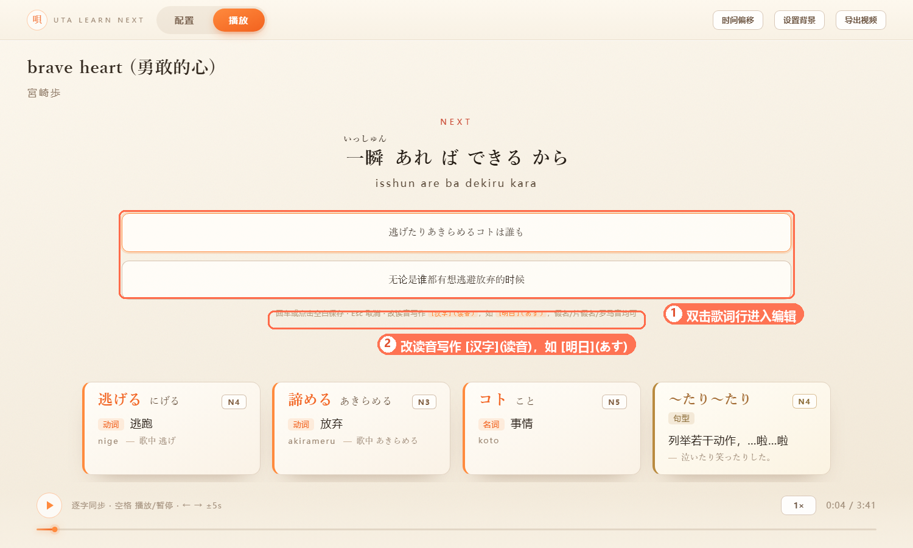

# Uta Learn Next

[](https://github.com/HaneWari/uta-learn-next/releases)
[](https://github.com/HaneWari/uta-learn-next/releases)
[](https://github.com/HaneWari/uta-learn-next/stargazers)
[](./LICENSE)

跟着日语歌学日语:**逐字**卡啦 OK 高亮、标注汉字的假名注音、罗马音、中文翻译,以及按真实词元
(辞书形 + 词性 + JLPT + 中文释义)和句型整理的词汇卡。可以把自己下载的音频配任意歌词源,
也能一键导出横屏 / 竖屏 / 4K 的 60fps 成片。
也能一键导出 1920×1080 / 60fps 的成片。

**本项目不提供相关音频资源，请自行获取**

本项目在[utalearn](https://github.com/rafaelanobre/utalearn)基础上开发而来。

---

## 界面预览

**跟唱舞台** —— 逐字高亮只标汉字的假名注音、罗马音、中文翻译；下方是当前这一句的词条卡与句型卡。


**配置** —— 放入自己下载的音频，三种来源选一份，剩下的交给它。


**选歌词 · 搜索** —— 一次查 QQ 音乐 / 酷狗 / Lrclib，带「逐字」的源有每个字的时间戳。


**选歌词 · 自定义** —— 粘贴自己的歌词文本，whisper 在你上传的音频上离线对齐；装扩展后可顺带生成中文翻译。


**已生成** —— 所有数据集都在这一步，随时回到跟唱或清理。


**改歌词、改卡片** —— 双击歌词行进编辑（含自定义读音写法）；双击卡片进入编辑、拖动排序、右键删除；右键空白处新建卡片或整首隐藏词条/翻译。




**导出前会检查环境** —— Playwright / Chromium 内核浏览器 / ffmpeg 逐项探测，缺了给「自动修复」或装 Chromium 扩展包的入口。


---

## 快速开始

**普通用户直接下发行包，免安装、解压即用。** 只有核心包必须下，两个扩展包按需——
而且两个扩展包都能在应用里**一键下载安装**（需要时会弹出对应入口），
无特殊情况不必手动去发行版页面。

| 压缩包 | 体积 | 说明 |
| --- | --- | --- |
| `UtaLearnNext-<版本>.zip` | ~290 MB | 完整应用：搜索歌词、生成、跟唱、词汇卡、歌词/卡片编辑。本机有任意 Chromium 内核浏览器（Chrome / Edge / Brave / 360 / QQ 等）即可直接导出视频。 |
| `UtaLearnNext-chromium.zip` | ~316 MB | 可选扩展包（**版本无关**）：内置 Chromium。本机没有 Chromium 内核浏览器又想导出视频时才需要——「导出视频」会先检测环境，缺了可点「安装 Chromium 扩展包」自动装好；手动解压到应用目录得到 `browsers/` 也行。 |
| `UtaLearnNext-custom-lyrics.zip` | ~490 MB | 可选扩展包（**版本无关**）：自定义歌词用的 whisper 识别 + 日→中翻译模型。在「自定义歌词」面板点「下载并安装扩展」自动装到 `models/`；手动解压到应用目录得到 `models/`（内含 `whisper-small/` 与 `translate-ja-zh/`）也行。不用自定义歌词就不用下。 |

核心包解压后双击 **`启动 Uta Learn Next.vbs`**（或 `启动 Uta Learn Next.cmd`）即可。
自带 Python 运行时、ffmpeg/ffprobe、pywebview 与已构建好的前端；不写注册表、不改 PATH、
不需要管理员权限。

- 默认启动一个**桌面窗口**（Edge WebView2 内核），不会再出现黑窗口
- 机器上没有 WebView2（例如部分 Win10 LTSC）时，自动改用系统浏览器打开
- 需要看后端日志时，用 `启动 Uta Learn Next (控制台).cmd`
- 窗口大小与位置会被记住，下次打开还在原处
- 设置里的「在浏览器中打开」可以两边同时用

需要导出但本机没有 Chromium 内核浏览器（Edge 也算，Windows 自带）时，再把 chromium
扩展包解压进来就行——程序下次启动会自动识别 `browsers/`，不用装、不用改配置。

两个扩展包都**与版本无关**：浏览器二进制和冻结的语音模型远比应用更新慢，
下载一次即可在任意版本上复用，升级应用不必重下。

数据默认写在文件夹内的 `localdata/` 与 `exports/`（便携语义，整个文件夹可拷走）；
如果文件夹不可写（例如解压到受保护目录），会自动回退到 `%LOCALAPPDATA%\UtaLearnNext\`。

<details>
<summary><strong>开发者：从源码运行</strong>（需要 Python 3.12+、Node.js 18+、PATH 里的 ffmpeg）</summary>

```bash
# Windows
dev.cmd              # 需要时才构建，单进程起在 :8000
dev.cmd --rebuild    # 强制重新构建前端

# macOS / Linux
./dev.sh             # 同上
./dev.sh --dev       # 前端走 vite :5173 热更新，API 仍在 :8000
```

首次运行会自动装依赖并构建前端，之后秒开；浏览器打开 <http://localhost:8000/>。
一个进程同时提供页面和 API，关掉窗口即停止。

```bash
cd backend && python -m uvicorn main:app --reload --port 8000   # 后端热重载
cd frontend && npm run dev                                       # 前端 vite 开发服
```

</details>

<details>
<summary><strong>自己打包发行版</strong></summary>

```bash
python tools/build_portable.py                    # 核心包 + chromium 扩展包
python tools/build_portable.py --no-chromium      # 只出核心包
python tools/build_portable.py --custom-pack      # 只出自定义歌词扩展包（whisper+翻译）
python tools/build_portable.py --no-zip           # 只生成文件夹
python tools/build_portable.py --out D:/build     # 换构建目录（磁盘空间不够时用）
python tools/build_portable.py --zip-out D:/rel --browsers-dir D:/br   # 大文件放别的盘
```

ffmpeg 用的是 **essentials（精简）构建**：静态链接、单个约 104 MB（全量版要 218 MB），
仍包含本应用需要的 `libx264`、`aac`、常见音频解码器与 `fps/setpts/tpad` 滤镜。
只有罕见格式（wma/ape/amr 等）可能解不开，导出与跟唱不受影响。

</details>

---

## 怎么用

界面分「配置」和「播放」两个标签页。

### 播放:跟唱与学习

把一根手指放在空格上就能用:

| 按键 | 功能 | 按键 | 功能 |
| --- | --- | --- | --- |
| `Space` | 播放 / 暂停 | `R` | 单句循环 |
| `←` / `→` | 上一句 / 下一句 | `F` | 跟读模式 |
| `Shift` + `←` / `→` | 后退 / 前进 5 秒 | `T` / `K` | 翻译 / 卡片 显示开关 |
| `[` / `]` | 降 / 升一档速度 | `?` | 快捷键一览 |
| `Esc` | 关闭弹窗、退出编辑 | `Ctrl+Z` | 撤销上一次卡片编辑 |

编辑输入框时不响应单键快捷键,避免和打字冲突。

- **单句循环**:按 `R`,当前这句唱完自动跳回它的开头,反复练一句。
- **跟读**:按 `F`,每句唱完自动暂停一会儿再继续,停顿时长按句子长度自动放大。
- **点词查词**:单击歌词里任意一个词,弹出读音、辞书形、词性、JLPT 与中文释义,
  可以「加入生词本」,也可以「从这句播放」。
- **生词本**:导航栏「生词本」,跨歌汇总、可搜索、可按歌筛选、可删;「回到这一句」跳回原曲那一行。
- **倍速** 0.25×–2×,点当前倍速展开选择。
- **时间偏移**:高亮总比歌声早或晚一点时,导航栏「时间偏移」给这首歌设 −2~+2 秒(0.1 秒精度)。
  正数让高亮与切句延后,负数提前;只影响这一首,导出同样生效。
- **设置背景**:导航栏「设置背景」可换纸感背景或自己的图片。
- **右键菜单**:右键舞台任意空白处 → 新建词条卡片 / 隐藏或显示词条卡片 / 隐藏或显示中文翻译。

### 设置

导航栏齿轮打开设置,分七组:常规、显示、歌词、网络、导出、扩展包、关于。常用的几项:

- **显示 → 助词读法**:「東京へ行こう」读 `toukyou e ikou`(按发音,默认)或 `toukyou he ikou`(按字面)。
  切换后所有已生成的歌立即按新读法显示,不用重新生成。
- **显示 → 长音写法**:`toukyou` / `tōkyō` / `tookyoo` 三选一,同样即时生效。
- **显示 → 主题 / 减少动效**:跟随系统、浅色、深色;对动效敏感可关掉入场动画。
- **歌词 → 默认搜索排序**:时长匹配、逐字优先、按来源。
- **网络 → 代理**:自动 / 系统 / 手动 / 关闭,带「测试」按钮;改完立即生效,不用重启。
- **导出**:默认预设与并行页数。
- **扩展包**:两个扩展包的安装状态。
- **关于**:版本号、应用目录、数据目录、导出诊断包、第三方许可。

设置存在 `localdata/settings.json`。

#### 歌词也可以改

- **双击当前歌词行**进入编辑：日文歌词、中文翻译分别一个输入框；
  回车或点击空白处保存，Esc 放弃。
- 只改翻译不会丢失逐字假名注音与擦过高亮；**改日文原文后**会按新文本重新分词，
  依然标注假名注音、罗马音并保留逐字高亮（时间轴按本句时长重新估算，不是原逐字数据）。
- **自定义读音**：歌词里某个汉字/词组要读成别的音（如歌词写「明日」但唱的是「あす」），
  在编辑框或自定义歌词输入框里写成 `[汉字](读音)`，例如 `[明日](あす)`、`[運命](さだめ)`；
  假名、片假名、罗马音（`[明日](asu)`）都认，方括号圆括号用中文全角也行。
  只标注读音不会丢逐字高亮。输入框旁有内联提示，照着写即可。
- 把歌词与翻译都清空后，这一句照常播放，只是不显示文字和高亮——
  想恢复时双击该位置的占位符重新编辑即可。

---

## 音频与歌词版本不一致怎么办

自己下载的音频常常和搜到的歌词不是同一版：片头被剪、TV size、重制版多一段。
两条时间轴只要时长差超过约 2 秒，生成前会提示**手动裁剪**——告诉程序哪一条
更长（歌词轴或音频）、从它内部的第几分几秒开始才是歌词真正唱的地方，生成时
就把短的那条裁到一致。不需要整段重对。

---

## 导出视频

导航栏「导出视频」把当前这首渲染成 MP4,音频直接混流,不重新编码音轨。先弹一个对话框:

- **三档预设,统一 60fps**:横屏 1920×1080、竖屏 1080×1920(短视频)、4K 3840×2160。
  4K 复用 1080p 的排版,只是渲染分辨率翻倍,版式不会变。
- **只导出片段**:打开开关后填起止时间(`m:ss`),只渲染这一段;音频在同一时刻切开。
- **预计耗时**:按预设、片段长度和并行页数估算,渲染中会显示进度百分比。

成片参数:

- 成片时长 = **音频实际时长**(不是歌词时间轴长度——两者常常差几十秒)
- 录制按播放进度结束,慢机器不会截掉尾巴
- 视频轨若比音频短,会克隆末帧补齐,最后几秒不会没画面
- **录制时间轴会重新对齐**:浏览器录出来的 WebM 并不保证覆盖真实经过的时间,
  实测一首 221 秒的歌画面被拉长约 1.4%,表现为「开头正常、越到后面字幕越晚」。
  现在用「播放开始→结束」的墙钟时长除以录制跨度得到缩放系数,`setpts` 校正后再转 60fps
- 录完会读成片进度条像素反推音画偏差,必要时自动重混一次;若校准结果不可信会跳过微调,
  并且一定会检查成片里真的有画面(不会出现只有声音的 MP4)

导出在**后台任务**里跑:可以关掉对话框,完成后用 toast 告知;导航栏「导出记录」列出
导出过的文件、大小与时间,可打开所在文件夹或删除。

点「导出视频」会先**检查导出环境**:Playwright 运行库、能启动的 Chromium 内核
浏览器、ffmpeg 三者缺一即弹出诊断,给出一键自动修复或安装内置 Chromium
扩展包的入口——而不是只报一句「导出不可用」。

需要 Playwright 驱动的 Chromium 内核浏览器与 ffmpeg——不一定是 Google Chrome,
**任何 Chromium 内核浏览器都行**(Windows 自带的 Edge、Brave、Vivaldi、360、QQ 等)。
浏览器路径可用 `UTALEARN_CHROME` 指定,否则按顺序探测:环境变量 → `browsers/` 扩展包 →
Playwright 缓存 → 各常见安装路径(Edge/Brave/Vivaldi/国产浏览器都在探测列表里)→ PATH。

导出实际用到**三个东西**,别和 `bin/` 里那个 ffmpeg 混淆:
playwright 包驱动浏览器、Chromium 渲染画面、playwright **自带的** ffmpeg 把帧
录成 webm(`record_video` 用,与 `bin/` 的 mux ffmpeg 是两份独立二进制)。
缺浏览器 → 自动修复或装 `UtaLearnNext-chromium.zip`;缺录制组件 → 自动修复会
补 `playwright install chromium ffmpeg`。

### 校验成片音画同步

```bash
python tools/check_export_sync.py exports/xxx.mp4 --audio localdata/<歌名>/audio.mp3
```

两项独立检查：把成片音轨与源音频做互相关（能发现音轨被移动或拉伸），以及读成片里
画进每一帧的进度条、与帧位置比较（能发现画面被缩放）。

> 进度条的像素映射本身有约 0.5% 的刻度偏差，所以 `BAR_LO/BAR_HI` 是实测标定出来的；
> 单看进度条会把工具误差当成画面误差，判断「是否漂移」时以谢幕卡这类**离散事件**为准。

---

## 词汇卡与语法卡

每句歌词下方最多 4 张卡（窗口窄时减少），语法命中占一席。

- **词卡**：辞书形 / 读音 / 词性 / JLPT / 中文释义，以及「歌中 X」提示原形
- **句型卡**：句型名 / 等级 / 中文解释 / 例句

选词**优先高阶**（同句内先挑 JLPT 更高的词），但**展示顺序仍按出现顺序**，不打乱阅读节奏。
落在句型范围内的词不会重复出卡。

词典约 **34,600 条**（其中 **18,100+** 条带 JLPT 分级），语法句型 **180 条**（N2 72 / N1 15）。
释义按词性区分义项。

#### 卡片可以自己动手改

自动选词难免认错（语气词被当成名词、想换一张更常用的词），所以每张卡都能改：

- **双击卡片**进入编辑：单词、读音、词性、JLPT、中文释义、句型名与例句，所有文字都能改；
  回车或点击空白处保存，Esc 放弃。
- **拖动排序**：按住卡片左右拖，其余卡片实时让位，松手即定——顺序按当前句保存，
  不影响下一句的自动选词。
- **右键卡片**删除该卡（有确认提示）。
- **右键舞台任意空白处**（歌词区、卡片之间、首尾卡外侧、词条带上下一带）弹出统一菜单：
  - **新建词条卡片**：当前不足 4 张时补一张空白卡自己填；已满时会提示先删一张。
  - **隐藏 / 显示词条卡片**：整首歌都不想要卡时一键收起，只剩一条细提示条，
    再右键可恢复；**隐藏状态下导出的视频也不会出现卡片和任何提示字样**。
  - **隐藏 / 显示中文翻译**：对整首歌生效；**隐藏状态下导出的视频也不含中文翻译行**。

所有修改按「歌 + 句」保存在数据集里，下次打开还在；改动也会带进导出的视频。

---

## 目录结构

```
desktop.py               桌面外壳:选端口、等后端、开窗口,失败退回浏览器
backend/
  main.py                只做装配:中间件 + 路由 + 静态 SPA
  app/
    api/                 路由按领域拆分(config / songs / export / packs / settings / update / stage)
    paths.py             应用目录、数据目录、导出目录的解析
    datasets.py          数据集命名、查找、音频格式与时长
    repo.py              song_data.json 的锁、原子写、备份与 schema 迁移
    guard.py             本地 API 防护(Host / Origin / 启动令牌)
    packs.py             扩展包下载与解压(流式、SHA256、防穿越)
    updater.py           更新检查、补丁暂存、应用与回退
    jobs.py              后台任务:资源分类、取消、持久化、SSE
    settings.py          settings.json 读写
    logs.py / telemetry.py  滚动日志、诊断包、匿名心跳
    vocab.py             生词本
    sources.py           QQ 音乐、酷狗、Lrclib 歌词源(并行搜索)
    builder.py           歌词 → 数据集(裁剪起点、时间重映射)
    fallback.py          whisper 切片转写 + 假名全局对齐 + 逐字锚定
    translate.py         离线日→中翻译(opus-mt int8 CT2 + sentencepiece)
    dicts.py             分词、词典/句型查询、罗马音(双读法)
    export.py            Playwright 录制 + ffmpeg 混流 + 自校准 + 三档预设
    data/                jadict.json(词典)、grammar.json(句型)
frontend/src/
  App.tsx                 标签页、导航栏、弹窗编排
  components/             ConfigPage / Stage / Player / LyricsDisplay / VocabCards /
                          SettingsModal / VocabBook / WordPopover / ExportDialog /
                          ExportList / ShortcutHelp / BackgroundModal / OffsetModal
  hooks/                  useSongData / useSyncEngine / usePlayback
  lib/                    纯逻辑:cards / romaji / words / shortcuts / saveQueue / settings / theme
  furigana.ts             只标汉字的注音切分
tools/                    数据构建、回归检查、便携包构建(见 tools/README.md)
  telemetry-worker/       Cloudflare Worker + D1 心跳统计端
localdata/                用户数据:数据集、设置、生词本(不提交)
exports/                  导出的成片(不提交)
```

## 运行数据在哪

- `localdata/<歌名>/song_data.json` — 时间轴、词元、词汇卡数据(schema v2,带 revision)
- `localdata/<歌名>/audio.<ext>` — 该数据集的音频,保留导入时的真实格式
- `localdata/settings.json` — 设置、匿名安装 ID
- `localdata/_vocab.json` — 生词本
- `localdata/_uploads/` — 上传暂存(24 小时后自动清理)
- `localdata/_ui/` — 播放页背景与窗口位置
- `localdata/logs/` — 滚动日志(2 MB × 5)
- `localdata/.jobs.json` — 任务记录(重启后未完成的标为「已中断」)
- `models/` — 扩展包模型目录(`whisper-small/`、`translate-ja-zh/`)
- `browsers/` — Chromium 扩展包
- `exports/` — 导出的 MP4

`localdata/`、`models/`、`browsers/` 与 `exports/` 都在 `.gitignore` 里。

## 环境变量

| 变量                  | 默认                    | 说明                                      |
| --------------------- | ----------------------- | ----------------------------------------- |
| `DATA_DIR`            | `../localdata`          | 数据集目录                                |
| `EXPORT_DIR`          | `../exports`            | 成片输出目录                              |
| `DEFAULT_SONG`        | `braveheart`            | 首次打开时的默认曲目                      |
| `UTALEARN_BASE_URL`   | 由请求推导              | 导出时无头浏览器访问本服务的地址          |
| `UTALEARN_CHROME`     | 自动探测                | 导出用的 Chromium 路径                    |
| `UTALEARN_DEV`        | 未设置                  | `1` = 跳过本地令牌校验(开发用)            |
| `UTALEARN_TELEMETRY`  | 未设置                  | `0` = 关闭匿名统计                        |
| `UTALEARN_NO_WINDOW`  | 未设置                  | `1` = 不开桌面窗口,改用系统浏览器         |
| `UTALEARN_DATA_DIR`   | `localdata`             | `tools/backfill_glosses.py` 的目标目录    |
| `UTALEARN_TOMOSHI_DB` | `tools/_source/…`       | 重建词典时的源数据库                      |

---

---

## 更新

启动约 10 秒后静默检查一次新版本(设置里可关)。发现更新时,设置按钮出现小圆点:

- **运行时没变 → 补丁更新**:约 1–5 MB,只替换 `backend/` 与 `frontend/dist/`;
  下载后提示重启,重启时换入新版本,旧版留在 `app.prev/` 方便回退。
- **运行时变了**(Python 版本、依赖或 ffmpeg 变化)→ 自动转为**完整包**,下载量更大。
- 补丁包是应用层的**全量包**,不依赖中间装过哪个版本,所以 v2.x 可以直接跳到最新的 v2.y。
- 每次都校验 SHA256;只从本仓库的 GitHub Release 下载,并遵循设置里的代理。
- 设置 → 关于里可以「回退到上一版本」。

v1.x(含 v1.3.0)没有更新器,需要下载一次 v2.0.0 完整包;歌曲数据、扩展包都能直接沿用。

## 隐私

默认开启**匿名使用统计**,只为知道大致有多少人在用、用的是哪个版本:

- 每台机器每天最多一次,内容只有随机安装 ID(UUIDv4)、版本号、系统大版本;
- 不含歌名、歌词、音频、文件路径、用户名、搜索词或任何功能使用记录;
- 由后端 Python 发送,没有 cookie,也没有浏览器指纹;
- 设置里可以随时关掉,关掉会删除本地安装 ID。

详见 [`PRIVACY.md`](PRIVACY.md)。

## 开发

```bash
# 后端(带热重载),需要 PATH 里有 ffmpeg
cd backend && python -m uvicorn main:app --reload --port 8000

# 前端(热更新,代理到 :8000)
cd frontend && npm run dev

# 桌面外壳
python desktop.py --port 8000

# 质量门禁(CI 跑的同一套)
cd backend && python -m ruff check . && python -m pytest
cd frontend && npx eslint src && npx tsc --noEmit && npm test && npm run build

# 导出音画同步回归检查
python tools/check_export_sync.py exports/xxx.mp4 --audio localdata/<歌名>/audio.mp3
```

主要接口:

- 配置:`/api/sources`、`/api/search`、`/api/uploads`、`/api/build`、`/api/build-text`
- 任务:`/api/jobs`、`/api/jobs/{id}`、`/api/jobs/{id}/cancel`、`/api/jobs/{id}/events`(SSE)
- 数据集:`/api/songs`、`/api/songs/{name}`(GET/PATCH/DELETE)、`/api/audio/{name}`
- 导出:`/api/export`、`/api/export/presets`、`/api/export/env`、`/api/export/fix`、
  `/api/export/install-chromium`、`/api/exports`、`/api/exports/reveal`
- 扩展包:`/api/models/status`、`/api/models/install`
- 设置:`/api/settings`、`/api/settings/test-proxy`、`/api/about`、`/api/diagnostics`
- 更新:`/api/update/check`、`/api/update/apply`、`/api/update/rollback`
- 生词本:`/api/vocab`(GET/POST/DELETE)
- 背景:`/api/ui/background`

测试:后端 221 个 pytest 用例、前端 47 个 vitest 用例;CI 还会在 Windows 上构建
便携包并跑一次启动冒烟。

## 许可与署名

本项目以 **GNU General Public License v3.0** 发布,全文见 [`LICENSE`](LICENSE)。
随发行包分发的第三方组件(ffmpeg、whisper、opus-mt、词典等)的许可与署名,
见 [`THIRD_PARTY_NOTICES.md`](THIRD_PARTY_NOTICES.md)。

`backend/app/qrc_des.py` 是从
[LDDC](https://github.com/chenmozhijin/LDDC)（GPL-3.0）移植的 QQ 音乐 QRC 解密实现，
它随本项目分发，因此整个项目按 GPL-3.0 授权。若你需要闭源分发，必须自行移除该文件与
QQ 音乐歌词源（酷狗走独立实现，Lrclib 无需解密）。

随仓库分发的词典数据 `backend/app/data/jadict.json` 是
[Tomoshi 日语词典开放数据层](https://github.com/tomoshi-app/tomoshi-dict-data) 的衍生作品
（CC BY-SA 4.0），其上游为 JMdict / KANJIDIC2（© Electronic Dictionary Research and
Development Group，CC BY-SA）。该数据文件同样按 **CC BY-SA 4.0** 分发，署名见上。

本项目在[utalearn](https://github.com/rafaelanobre/utalearn)基础上开发而来。
日语形态素分析使用 [fugashi](https://github.com/polm/fugashi) + UniDic。
语音识别使用 [faster-whisper](https://github.com/SYSTRAN/faster-whisper)。

歌词内容来自 QQ 音乐、酷狗、Lrclib，仅用于个人学习，请遵守各来源的服务条款；
分发由本工具生成的、包含受版权保护歌词的数据集可能构成侵权。